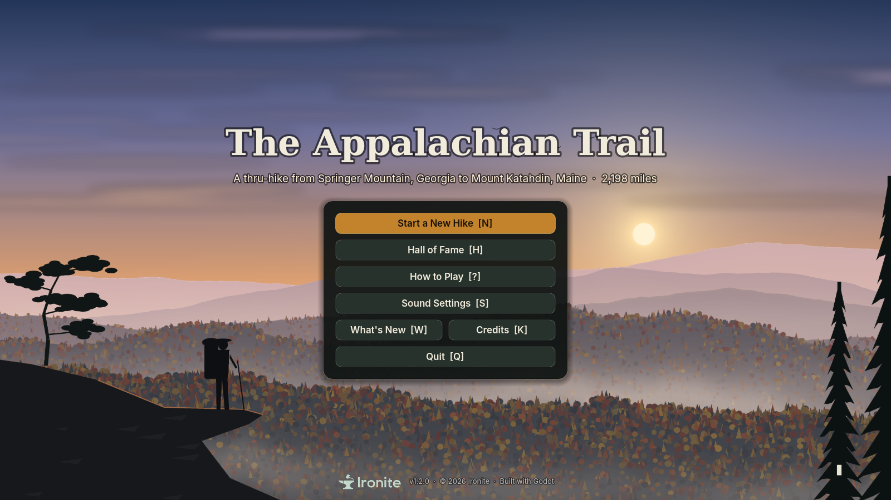
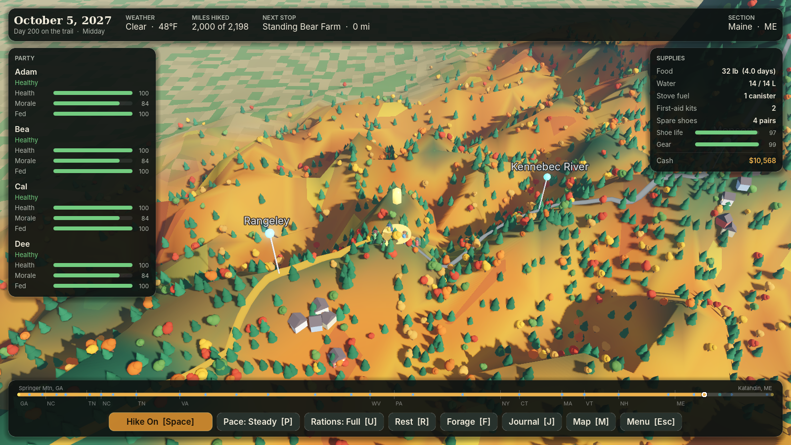
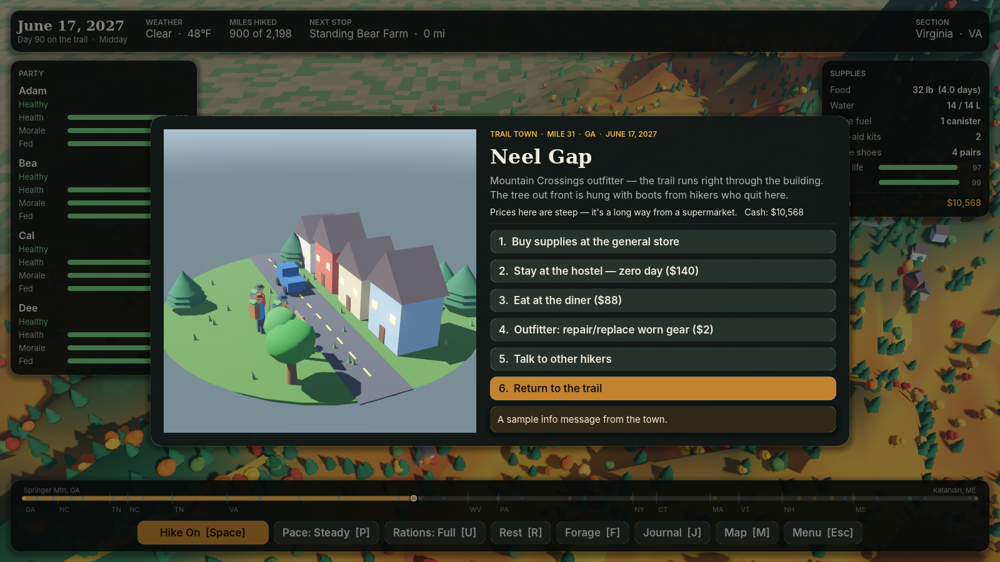
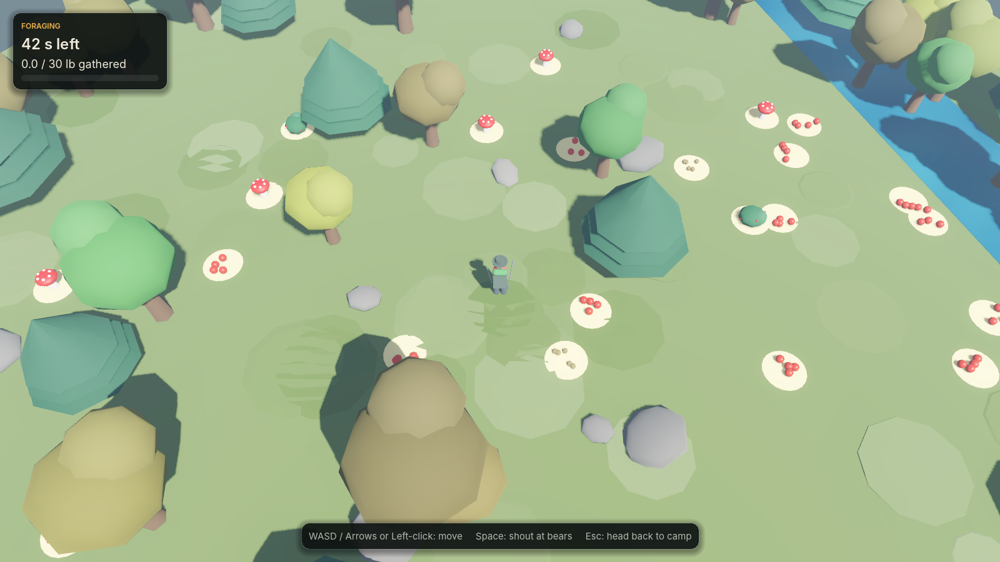

# The Appalachian Trail

An Oregon Trail–style thru-hike from Springer Mountain, Georgia to Mount Katahdin, Maine (2,198 miles), built in Godot 4.3. An Ironite game. See [CHANGELOG.md](CHANGELOG.md) for version history and [CREDITS.md](CREDITS.md) for credits. Both are also viewable in-game from the title screen (What's New and Credits).



## Download & install

Get the latest version from the [Releases page](https://github.com/adamglassner/appalachiantrail/releases/latest):

- **`AppalachianTrail-Setup-<version>.exe`** (recommended): installs the game for your Windows user account, with no administrator rights needed. It adds Start menu and Desktop shortcuts and an uninstall entry in **Settings → Apps**. Running a newer Setup updates the game in place and keeps your saves.
- **`AppalachianTrail-<version>-Windows-Portable.zip`**: unzip it anywhere and run `AppalachianTrail.exe`. Nothing gets installed.

The downloads aren't code-signed, so Windows SmartScreen may say "Windows protected your PC". Click **More info → Run anyway**.

Saved hikes, the Hall of Fame and settings are stored in `%APPDATA%\Godot\app_userdata\The Appalachian Trail\`.

The game uses the Forward+ renderer (Vulkan). On PCs without Vulkan it falls back to OpenGL automatically.

## Building from source

- **Play or edit:** open this folder in **Godot 4.3** (Project Manager → Import → pick `project.godot`). Press F5 to run.
- **Build a release:** with Godot 4.3 and its export templates installed, run:

  ```bash
  GODOT=/path/to/godot tools/build_release.sh
  ```

  It brands the Windows template with the game icon and Ironite version info (`tools/pe_resources.py`, so no rcedit is needed) and exports the game. It then packs the game into the installer (`installer/`, a small Godot project of its own) and writes the Setup .exe and portable .zip to `build/`.
- **Regenerate assets:** `python3 tools/gen_audio.py` re-synthesizes the music and sound. `python3 tools/gen_wallpaper.py` repaints the title wallpaper.

## How to play

Pick a profession (it sets your budget and score multiplier), name 1–4 hikers, choose a start date, and buy supplies in Dahlonega. Then hike north one day at a time.

| Key | Action |
|---|---|
| Space | Hike on / stop (auto-travels day by day) |
| P | Change pace: Slow / Steady / Push |
| U | Change rations: Full / Half / Bare |
| R | Rest (zero day) |
| F | Forage minigame |
| T | Visit town (when you're in one) |
| J | Journal |
| M | Toggle map overview |
| Esc | Menu (save, sound settings, help, quit) |
| F5 | Quick save |
| 1–6 | Pick an option in events and towns |
| Mouse wheel, + / − | Zoom |
| Right-drag, Q / E | Rotate the camera |

The game autosaves every day. Pick **Continue Your Hike** on the title screen to resume.

## What's in it

- **Trail:** 44 real landmarks and trail towns, from Neel Gap, the Smokies, Damascus, McAfee Knob, Shenandoah, Harpers Ferry, the Pennsylvania rocks and the Whites to Mahoosuc Notch, the Kennebec ferry, the 100-Mile Wilderness and Katahdin.
- **Party:** each hiker has health, morale and hunger. Injuries and illnesses include blisters, shin splints, sprains, giardia, norovirus, Lyme disease, hypothermia, heat exhaustion and broken wrists. First-aid kits halve recovery time. Hikers earn trail names along the way.
- **Supplies:** food, water capacity, stove fuel, first-aid kits, spare shoes (every ~500 miles) and gear condition.
- **Events:** bear encounters, bears visiting camp at night, river crossings, lightning on exposed ridges, getting lost in fog, trail magic, shelter mice, hikers in trouble, new hikers asking to join, rattlesnakes and more. Most events give you choices.
- **Landmark challenges:** the Smokies permit, the half-gallon ice cream challenge, Mount Washington's weather, Mahoosuc Notch, fording or ferrying the Kennebec, and a 100-Mile Wilderness food check.
- **Towns:** general store (prices vary by town), hostel zero days, diners, outfitter gear repair, and advice from other hikers.
- **Foraging minigame:** gather in-season wild food (ramps, morels, chanterelles, blackberries, blueberries, apples and more) in 45 seconds. Avoid red-capped Amanita mushrooms and blow your whistle to scare off bears.
- **Deadline:** Baxter State Park closes Katahdin on October 15.
- **Score:** surviving hikers' health, supplies, cash, gear and speed, multiplied by your profession. Top 10 runs go in the Hall of Fame.

## Graphics

| | |
|---|---|
|  |  |
|  |  |


All graphics are procedural, with no imported art.

- **Map:** stylized 3D terrain generated from the trail's real coordinates, with the Atlantic coastline, about 22,000 instanced trees and little town buildings.
- **Seasons:** the forest buds in spring, turns green in summer, then shows fall color, moving northward with the calendar. High summits get snow in the shoulder seasons.
- **Time and weather:** a full day/night cycle (stars, moon, sunsets, campfire at night), plus rain, snow, fog, cloud cover and lightning.
- **Event scenes:** shown as floating-island 3D dioramas: river, bear, town, storm, injury, trail magic, vista, camp, summit, ponies, rocks, snake and forest.

## Sound

All music and sound is original and synthesized in code by `tools/gen_audio.py` (Python + numpy/scipy + ffmpeg), so there are no licensing questions.

- **Music** (old-time / bluegrass style, with plucked guitar, banjo, fiddle, harmonica and bass): "Springer Dawn" (title waltz), "Ridge Walk" (on the trail), "Trail Town" (in towns), "Shelter Fire" (night), a foraging tune, plus victory and game-over pieces.
- **Ambience** that follows the weather and time of day: forest birdsong and wind, night crickets with a campfire and a distant owl, rain, thunderstorms, mountain wind, rivers and town bustle.
- **Effects:** footsteps while hiking, rolling thunder after each lightning flash, bear growls, river splashes, snake rattles, trail-magic and event chimes, cash register, camera shutter, foraging pickups, a bear whistle and button clicks.
- **Volume:** Esc → Sound Settings (or S on the title screen) has Master, Music, Nature & weather and Effects sliders. Settings are remembered.

To change the music, edit the melodies and chord charts in `tools/gen_audio.py` and run `python3 tools/gen_audio.py` (or `python3 tools/gen_audio.py music` for just the music).

## Code map

| File | Purpose |
|---|---|
| `scripts/game_state.gd` | Autoload `Game`: party, supplies, daily simulation, store, scoring, save/load |
| `scripts/trail_data.gd` | Landmarks, regions, hiker advice |
| `scripts/trail_events.gd` | Random events, landmark challenges and choice outcomes |
| `scripts/main.gd` | Screens, HUD, travel loop, event queue, towns, store, journal, endings |
| `scripts/world_map.gd` | Procedural 3D overworld, forest, trail ribbon, party marker, camera |
| `scripts/atmosphere.gd` | Sky, sun/moon, fog, rain/snow, lightning |
| `scripts/diorama.gd` | Event dioramas |
| `scripts/forage_game.gd` | Foraging minigame |
| `scripts/props.gd` | Low-poly prop builders |
| `scripts/ui_theme.gd` | UI theme and widgets |
| `scripts/audio_manager.gd` | Autoload `Audio`: music crossfades, ambience, effects, volume settings |
| `tools/gen_wallpaper.py` | Paints the layered title wallpaper into `art/menu/` |
| `scripts/menu_backdrop.gd` | Title backdrop with parallax and drifting mist |
| `tools/gen_audio.py` | Generates every music track, ambience loop and sound effect into `audio/` |
| `tools/build_release.sh` | Builds the Setup .exe and portable .zip |
| `tools/pe_resources.py` | Writes the icon and version info into Windows .exe files without rcedit |
| `installer/` | The Setup program: a separate Godot project with a per-user install, shortcuts and an uninstaller |
| `scripts/dev_runner.gd` | Dev-only tools: screenshots, balance simulation, UI autoplay. Not included in the export. |

Dev tools: run with `-- --sim=150:steady` for a balance report or `-- --autoplay=3` to play through the real UI automatically.
